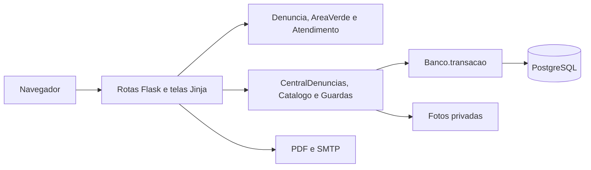

# Arquitetura e pilares de POO

O site executa em um processo Flask com múltiplas threads. O PostgreSQL é a fonte dos dados de negócio. Cada operação abre uma conexão com a conta `alerta_app`. O envio de e-mail ocorre depois do commit, portanto uma indisponibilidade do SMTP preserva o protocolo.

## Onde os quatro pilares aparecem

| Pilar | Decisão no código | Como mostrar |
| --- | --- | --- |
| Abstração | A classe abstrata `Denuncia` declara o contrato `identificacao()`. O serviço de registro precisa saber quais valores pode persistir. | Em `alerta/dominio.py`, abra o método marcado com `@abstractmethod`. |
| Herança | `DenunciaPublica` e `DenunciaAnonima` herdam categoria, descrição e ponto de referência. A identificada acrescenta nome e e-mail. | Compare as duas classes e os campos recebidos na fábrica `do_formulario`. |
| Polimorfismo | `CentralDenuncias.registrar` chama `denuncia.identificacao()`. O mesmo INSERT recebe os dados da identificada ou o par de valores nulos da anônima. | Siga a chamada em `alerta/denuncias.py` e mostre o comportamento de cada subtipo. |
| Encapsulamento | `Atendimento` reúne estado e regras em `destinos` e `responder`. As entidades são imutáveis após a construção. `AcessosTemporarios` mantém sessões e tentativas em atributos internos protegidos por trava. | Explique por que um POST que tenta passar de Recebida para Resolvida é recusado mesmo quando o navegador é ignorado. |

## Componentes e persistência

- `alerta/__init__.py` cria a aplicação, configura dependências, autentica requisições e encaminha dados para os objetos de domínio. Os templates apresentam textos com escape automático.
- `alerta/banco.py` reúne a unidade de transação, o catálogo de áreas e a autenticação. A conta técnica do banco e a identidade do guarda têm finalidades diferentes. O guarda entra no site por e-mail e senha, e o servidor confere sua titularidade em cada operação administrativa.
- `alerta/denuncias.py` grava o caso, consulta detalhes e coordena o atendimento. A trigger acrescenta o primeiro evento durante o INSERT. Uma resposta executa UPDATE e INSERT de histórico na mesma transação. Uma exceção reverte ambos.
- `alerta/comprovantes.py` valida e recodifica o PNG sem metadados, gera o PDF e integra SMTP. A imagem fica em pasta privada com nome aleatório. A aplicação verifica autorização antes de enviá-la.
- `alerta/seguranca.py` gera e verifica hashes Argon2id com salt. O código de acompanhamento de 96 bits deriva de um nonce aleatório por formulário e de uma chave do servidor. O banco recebe somente o verificador e a impressão do token de envio. O mesmo formulário pode recuperar o mesmo comprovante durante sua validade.
- `sql/` mantém as quatro tabelas, chaves, restrições, índices, trigger, contas, permissões e view. O painel consulta diretamente as tabelas para aplicar a titularidade. A view é destinada à conta de relatórios.

## Consistência sob concorrência

No registro, a leitura da área com `FOR SHARE` e a inserção participam da mesma transação. Desativar a área disputa o bloqueio da mesma linha. O índice único de `token_envio` identifica um reenvio e impede um segundo recebimento. Quando o envio é repetido, o site devolve o protocolo existente e envia o e-mail apenas no primeiro registro.

No atendimento, o servidor bloqueia a denúncia com `FOR UPDATE`, compara a versão da tela com `atualizado_em` e valida a transição no objeto `Atendimento`. O histórico registra a resposta mesmo quando a situação permanece igual. No login, os contadores de falhas são atualizados sob bloqueio da linha do guarda.

## Decisões de execução

O catálogo, os atendimentos e os bloqueios de login persistem no PostgreSQL. Sessões de guarda e tentativas de consulta pública ficam na memória de um único processo. Em uma reinicialização, o guarda entra novamente e o contador público recomeça. Uma implantação com mais de um processo deverá compartilhar esse estado entre eles. A demonstração funciona em HTTP no loopback. As opções para implantação em HTTPS estão no guia de operação.

