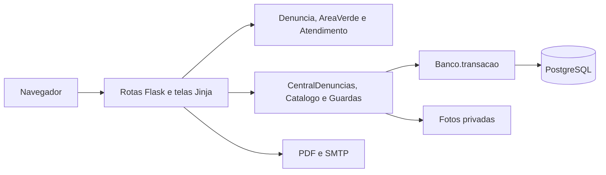

# Arquitetura e pilares de POO

Quando alguém registra uma denúncia, o Flask recebe o formulário e chama `Denuncia.do_formulario()`. Esse método confere os campos e cria uma denúncia identificada ou anônima. `CentralDenuncias` recebe o objeto e grava a ocorrência no PostgreSQL. O banco já acrescenta o evento **Recebida** ao histórico, e o site mostra o protocolo e o comprovante.

## Onde os quatro pilares aparecem

| Pilar | Como aparece no projeto | Onde ver |
| --- | --- | --- |
| Abstração | Toda denúncia tem categoria, descrição e ponto de referência. A classe abstrata `Denuncia` também exige que cada tipo informe quais dados de identificação podem ser gravados. | [`Denuncia` e `identificacao()`](../alerta/dominio.py#L64) |
| Herança | `DenunciaPublica` e `DenunciaAnonima` herdam os três campos de `Denuncia`. A identificada acrescenta nome e e-mail. | [As duas subclasses](../alerta/dominio.py#L90) |
| Polimorfismo | O serviço chama `denuncia.identificacao()` do mesmo jeito para os dois tipos. A identificada devolve o nome e o e-mail. Na anônima, esses dois campos seguem vazios para o banco. | [Chamada no serviço de registro](../alerta/denuncias.py#L21) |
| Encapsulamento | `Atendimento` guarda a situação e reúne as regras para responder. A tela mostra os destinos permitidos, e o servidor confere a escolha antes de gravar. Por exemplo, uma denúncia **Recebida** só muda para **Em análise**. `AcessosTemporarios` também guarda sessões e tentativas em atributos internos. | [`Atendimento`](../alerta/dominio.py#L106) e [`AcessosTemporarios`](../alerta/seguranca.py#L26) |

## Componentes e persistência

- [Rotas do Flask](../alerta/__init__.py) recebem os formulários, verificam quem pode acessar cada tela e chamam as classes que cuidam das regras. Os templates do Jinja tratam o texto enviado pelos usuários antes de exibi-lo.
- O site se conecta ao PostgreSQL como `alerta_app`. O guarda entra com seu próprio e-mail e senha, e cada operação do painel verifica se a área está ligada à conta dele. [Conexão, áreas e guardas](../alerta/banco.py)
- Quando o guarda salva uma resposta, o sistema atualiza a situação e grava o histórico juntos. Se uma gravação falhar, o banco desfaz as duas. Esse conjunto de operações é uma transação. [Registro e atendimento](../alerta/denuncias.py)
- O site confere o PNG, remove os metadados e guarda o arquivo com um nome aleatório em uma pasta privada. Quando o SMTP está configurado, envia o PDF por e-mail depois de gravar a denúncia. Se o e-mail falhar, o visitante mantém o protocolo e pode baixar o PDF. [Fotos e comprovantes](../alerta/comprovantes.py)
- O site usa Argon2id para proteger senhas e conferir códigos de acompanhamento. No registro, gera o código de acesso a partir do formulário e de uma chave do servidor. O PostgreSQL guarda o verificador do código e o hash do token de envio. [Senhas e sessões](../alerta/seguranca.py) · [Geração do código](../alerta/denuncias.py#L16)
- [Scripts SQL](../sql/) criam as quatro tabelas, as chaves e restrições, os índices, a trigger, as contas e a view. O painel consulta as tabelas com o filtro do guarda. A conta `alerta_leitura` pode consultar a view para relatórios.

## O que acontece quando duas ações ocorrem ao mesmo tempo

Se alguém tentar denunciar enquanto o guarda desativa a área, o banco executa as duas operações em ordem. O registro usa `FOR SHARE` para manter a área estável entre a conferência e a gravação. Se a área já estiver inativa na hora da conferência, o site recusa o registro.

Se o visitante repetir o envio de um formulário ainda válido, o índice único em `token_envio` impede um registro duplicado. O site devolve o protocolo que já existe. O envio por e-mail só é tentado no primeiro registro.

Se o guarda abrir o mesmo atendimento em duas abas e salvar na primeira, a segunda fica desatualizada. O servidor usa `FOR UPDATE` e compara `atualizado_em` com a versão enviada pela tela. Se os valores forem diferentes, pede que o guarda recarregue a página. O histórico também recebe respostas que mantêm a situação atual. No login, o banco atualiza o contador de erros de uma tentativa por vez para cada conta.

## Decisões de execução

Áreas, atendimentos e bloqueios de login ficam no PostgreSQL. As sessões dos guardas e as tentativas de consulta pública ficam na memória do Flask. Quando o site reinicia, o guarda precisa entrar de novo e o contador de tentativas de consulta recomeça. A demonstração roda em um processo e abre no próprio computador. Se o site for hospedado com vários processos, eles precisarão compartilhar as sessões e o contador. [Guia de operação](operacao.md#https-e-dados-locais)

